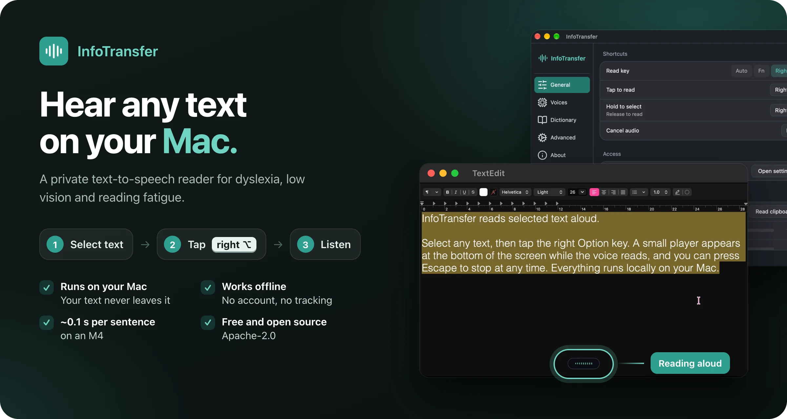

# Hi, I'm Sagar

<!-- TODO(Sagar): add a line about yourself, e.g. what you do, where you're based, or what you're open to. -->
I build tools that run locally and respect the people who use them: an accessible text-to-speech reader for macOS, a self-contained TLA+ course, and an offline ebook reader. Most of what I write is Rust, with TypeScript, Swift and Go along the way.

## Recent work

### [InfoTransfer](https://github.com/sxxrfx/infotransfer)

Select text anywhere on your Mac, tap one key, hear it read aloud. Local, private text-to-speech for dyslexia, low vision and reading fatigue. 
Rust · GPUI · ONNX Runtime · macOS 14+ · [Website](https://sxxrfx.github.io/infotransfer/) · [Download v0.1](https://github.com/sxxrfx/infotransfer/releases/latest)

### [TLA+ Course](https://github.com/sxxrfx/tla-plus-course)

An offline, visual course following Lamport's TLA+ video lectures and going beyond them, with problem sets built from real systems and every spec checked with TLC. 
TLA+ · HTML/JS · Python · Swift + Rust macOS app · [Take the course](https://sxxrfx.github.io/tla-plus-course/)

### BookWyrm in progress

A calm ebook reader for Android and iOS. Offline, no account, and your books stay on your device. Not public yet. 
TypeScript · React Native · Expo

## Earlier experiments

- **Interpreters:** [craftinginterpreters-tut](https://github.com/sxxrfx/craftinginterpreters-tut), a tree-walking Lox interpreter in Java; [regex-from-scratch](https://github.com/sxxrfx/regex-from-scratch), a regex engine built on a finite state machine in Rust.
- **Rust data structures and concurrency:** [cache](https://github.com/sxxrfx/cache) (LRU cache), [trie-rs](https://github.com/sxxrfx/trie-rs), [channels](https://github.com/sxxrfx/channels), [arc](https://github.com/sxxrfx/arc).
- **Graphics and games:** [fractal-shaders](https://github.com/sxxrfx/fractal-shaders) (WGSL shaders in Bevy), [music-visualizer](https://github.com/sxxrfx/music-visualizer) (raylib + cpal), [space-invaders-rs](https://github.com/sxxrfx/space-invaders-rs) (Bevy), [julia_set](https://github.com/sxxrfx/julia_set) (Julia set GIFs from the CLI).

## Tech and interests

Rust, TypeScript, Swift, Go, Kotlin, Python · accessibility, formal methods, local-first software, interpreters, graphics

## Elsewhere

[X / Twitter @sxxrfx](https://x.com/sxxrfx)
<!-- TODO(Sagar): add a personal site, email, LinkedIn or anything else you want listed here. -->
